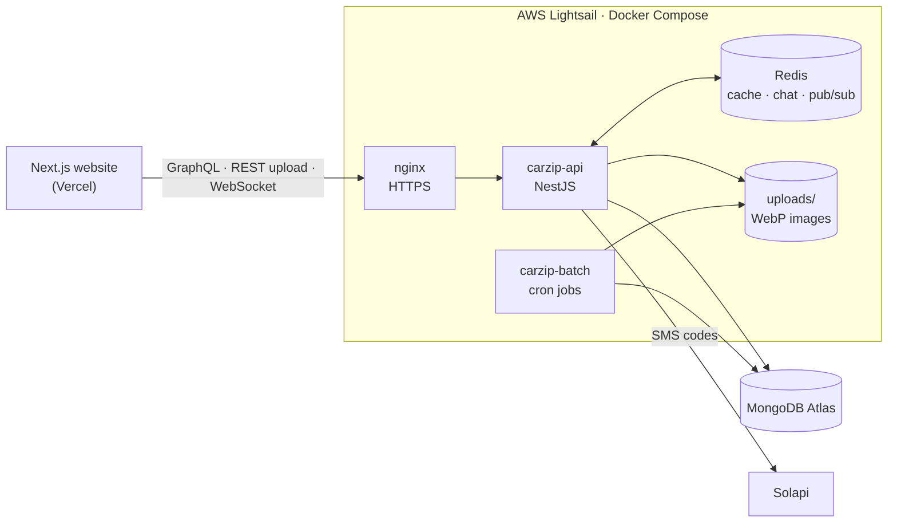

# CarZip — Backend

**GraphQL backend for a used-car marketplace in Korea: verified dealers list cars, buyers search, like, comment, chat and book test drives, and admins moderate everything.**


**Live:** [carzip.kr](https://www.carzip.kr) · **API:** `https://api.carzip.kr/graphql` · **Frontend repo:** [CarZip-next](https://github.com/sanchezSanjar/CarZip-next) · **API guide:** [API.md](./API.md)

---

## Table of contents

- [Overview](#overview)
- [Architecture](#architecture)
- [Features](#features)
- [Tech stack](#tech-stack)
- [Project structure](#project-structure)
- [Getting started](#getting-started)
- [Testing](#testing)
- [Deployment](#deployment)
- [Design decisions](#design-decisions)
- [Roadmap](#roadmap)
- [Author](#author)

---

## Overview

CarZip is a marketplace where **only verified dealers can sell**. A dealer signs up with a business registration number, an admin approves the account, and the dealer can then list cars for the Korean market (KRW), for export (USD) or both. Buyers browse with rich filters, save favorites, follow dealers, ask questions in comments or the live chat, and request test drives — the dealer only sees the buyer's phone number after confirming the meeting.

The project is a **NestJS monorepo with two applications** that share one data layer:

| App | Role |
|---|---|
| `carzip-api` | GraphQL API, REST image upload, WebSocket live chat |
| `carzip-batch` | Scheduled jobs: rankings, test-drive housekeeping, cleanup, reminders, counter checks |

## Architecture



- **One database, two processes:** the API answers requests; the batch server runs timed jobs against the same MongoDB, so slow work never blocks a request.
- **Redis is optional by design:** it caches statistics and carries live-chat messages between API instances. If Redis is down, the API keeps working (no cache, chat history in memory).
- **Images never leave the server unprocessed:** every upload is decoded and re-encoded to WebP with a thumbnail, which also strips EXIF data such as GPS location.

## Features

### Members and authentication
- Three roles: **USER** (buyer), **AGENT** (verified dealer) and **ADMIN**
- JWT authentication; every request re-reads the member from the database, so a block, a password change or a role change takes effect on the very next request
- **SMS one-time codes** (Solapi) for signup, forgot password and phone change — codes are stored as an HMAC, attempt-limited and rate-limited per phone and per IP
- Login limit: 5 failed attempts per account (30 per IP) in 15 minutes
- Dealers wait in `PENDING` until an admin approves them; admins can also create dealer accounts directly

### Cars
- Listings for the **domestic market (KRW)**, **export (USD)** or **both**, with an export-responsibility agreement stored per listing
- Brand → model catalogue, ~20 filters, sorting by price, mileage, year, likes, views or rank, and **cursor pagination** (stable even when many cars share the same value)
- Likes, comments, unique view counts, favorites and "recently viewed"
- Status flow `ACTIVE → HOLD → SOLD / DELETE`, with admin holds the dealer cannot lift
- Listings nobody touched for 30 days trigger a "still for sale?" reminder

### Test drives
- Buyer requests a date (within 60 days) → dealer confirms or rejects → dealer marks it complete after the date; either side may cancel a confirmed one
- **Privacy rule:** the buyer's phone number is visible to the dealer only after confirmation
- Open test drives are cancelled automatically when the car is sold, paused or removed, when the dealer blocks the buyer, or when an admin blocks either side — and both sides are notified

### Community, moderation and real time
- Board articles (dealers and admins), follows (members follow dealers), notifications with read/unread state
- **Personal block:** a dealer can stop a member from liking, commenting, following or booking test drives on their listings
- Admin moderation of members, cars, articles and comments; notices, FAQ and terms pages
- **Live chat over WebSocket:** guests read, members write; messages are validated and rate-limited, and the history keeps the last 20 messages of the past 7 days

### Batch server (Korea time)

| Job | Schedule |
|---|---|
| Car and dealer rankings | daily 01:00 |
| Expire unanswered test-drive requests · remind before confirmed ones · follow up afterwards | every 10 min / hourly |
| Delete uploaded images nothing references | daily 03:00 |
| Recount every stored counter (likes, views, followers…) and fix any drift | daily 04:00 |
| Remind admins about dealer applications waiting over 48 hours | daily 09:00 |
| Ask dealers whether listings untouched for 30 days are still for sale | daily 10:00 |

Every job is **idempotent**: each write is conditional on the current state, so running a job twice never applies or announces anything twice.

## Tech stack

| Area | Technology |
|---|---|
| Framework | NestJS 12 (monorepo), TypeScript 6 |
| API | GraphQL (Apollo Server 5, code-first), REST for image upload |
| Database | MongoDB with Mongoose 8 — aggregation pipelines, unique, partial and TTL indexes |
| Cache and messaging | Redis (ioredis) — cached statistics, chat history, pub/sub between API servers |
| Real time | WebSocket (`ws` adapter) |
| Auth and security | JWT, bcrypt, role guards, helmet, login and SMS rate limits |
| Validation | class-validator / class-transformer with a global `ValidationPipe` |
| Scheduling | `@nestjs/schedule` (cron) |
| Images | sharp (WebP re-encoding, thumbnails) |
| SMS | Solapi |
| Testing | Vitest |
| Deployment | Docker, Docker Compose, nginx, AWS Lightsail, MongoDB Atlas |
| Code quality | ESLint 9, Prettier |

## Project structure

```
apps/
├── carzip-api/                 GraphQL API, WebSocket chat, image upload
│   └── src/
│       ├── components/         one module per feature
│       │                       auth · member · car · test-drive · comment · like · follow · block
│       │                       board-article · notice · notification · otp · sms · upload · view
│       ├── libs/               GraphQL DTOs, guards, interceptors, query helpers
│       └── socket/             WebSocket chat gateway
└── carzip-batch/               scheduled jobs
    └── src/                    rankings · test drives · uploads cleanup · reminders · counter check
libs/
└── common/                     shared by both apps (imported as @app/common)
    └── src/                    Mongoose schemas · enums · database and Redis modules · config
API.md                          full API guide for frontend developers
Dockerfile, docker-compose.yml  production image and stack (API + batch + Redis)
```

Each feature module follows the same layout: a **resolver** (GraphQL entry point, guards and roles), a **service** (business rules) and **DTOs** (validated input and output types).

## Getting started

### Prerequisites

- Node.js 20 or newer (the Docker image uses Node 24)
- MongoDB — local or a free MongoDB Atlas cluster
- Redis — optional for local development

### Installation

```bash
git clone https://github.com/sanchezSanjar/CarZip.git
cd CarZip
npm install
```

### Environment variables

Create `.env` in the project root:

```env
PORT_API=3007
PORT_BATCH=3008

MONGO_DEV=mongodb://localhost:27017/carzip
MONGO_PROD=

# optional: without it there is no cache and the chat history stays in memory
REDIS_URL=redis://localhost:6379

SECRET_TOKEN=a-long-random-string

# optional: without them, SMS codes are only written to the log
SOLAPI_API_KEY=
SOLAPI_API_SECRET=
SOLAPI_SENDER_NUMBER=

# production
CORS_ORIGINS=https://your-domain.com,https://www.your-domain.com
UPLOADS_PUBLIC_URL=https://api.your-domain.com
TRUST_PROXY=1          # number of proxies (e.g. nginx) in front of the API
```

### Run

```bash
npm run start:dev          # API    → http://localhost:3007/graphql
npm run start:dev:batch    # batch server
```

Open `http://localhost:3007/graphql` to explore the schema and try queries. [API.md](./API.md) documents every query and mutation, who may call it, the business rules and the error messages.

### Scripts

| Command | Description |
|---|---|
| `npm run start:dev` | API in watch mode |
| `npm run start:dev:batch` | batch server in watch mode |
| `npm run build` / `npx nest build carzip-batch` | compile the API / the batch server |
| `npm run start:prod` / `npm run start:prod:batch` | run the compiled apps |
| `npm test` | unit tests |
| `npm run lint` · `npm run format` | ESLint · Prettier |

## Testing

```bash
npm test
```

The unit tests check business rules with fake models, so they need **no database, network or SMS**: the login limit, personal blocks, admin role changes, chat history expiry, upload checks, signup rules and the Redis cache fallback. The Docker build runs them on every deploy, so a failing rule stops the release.

## Deployment

Production runs on a single **AWS Lightsail** instance:

```
Internet → nginx (HTTPS, Let's Encrypt) → Docker: carzip-api ─┬─ Redis
                                          Docker: carzip-batch ┘
                                                    │
                                              MongoDB Atlas
```

```bash
docker compose up -d --build    # build (runs the tests), then start API, batch server and Redis
docker compose ps               # status
docker compose logs -f api      # logs
```

- The API listens on `127.0.0.1:3007` only — nginx is the single public entry point and also upgrades the WebSocket connection for the chat
- Uploaded images live in `./uploads` on the host, so they survive rebuilds
- Containers restart automatically after a crash or reboot; logs are size-limited
- The website is deployed separately on Vercel ([CarZip-next](https://github.com/sanchezSanjar/CarZip-next))

## Design decisions

- **Server-side rules, not client-side:** every permission and business rule (who may move a test drive to which status, who sees a phone number, who may like what) is enforced in the service layer; the frontend only reflects it.
- **Race-safe writes:** likes, follows, blocks and status changes use unique indexes and conditional atomic updates, so double taps or two devices can never double-count or both succeed.
- **Counters with a safety net:** counters are kept with `$inc` for fast reads, and a nightly job recounts them from the source records and fixes any drift.
- **Privacy by default:** aggregations project only public fields; password hashes, phone and business numbers never appear in lists. Tokens and chat text are never logged.
- **Self-cleaning data:** TTL indexes expire OTP codes, failed-login records and old notifications; chat history keeps 7 days; a nightly job removes images nothing uses.

## Roadmap

- [x] GraphQL API, batch server, WebSocket chat
- [x] Security hardening: helmet, login limit, `trust proxy`, rate-limited SMS
- [x] Redis cache and chat pub/sub
- [x] Unit test suite, Docker deployment
- [x] Web frontend ([CarZip-next](https://github.com/sanchezSanjar/CarZip-next))
- [ ] Live notification push over WebSocket
- [ ] Object storage (S3 / Cloudflare R2) for images
- [ ] Refresh tokens and a mobile app

## Author

**Sanjar** — [github.com/sanchezSanjar](https://github.com/sanchezSanjar)
